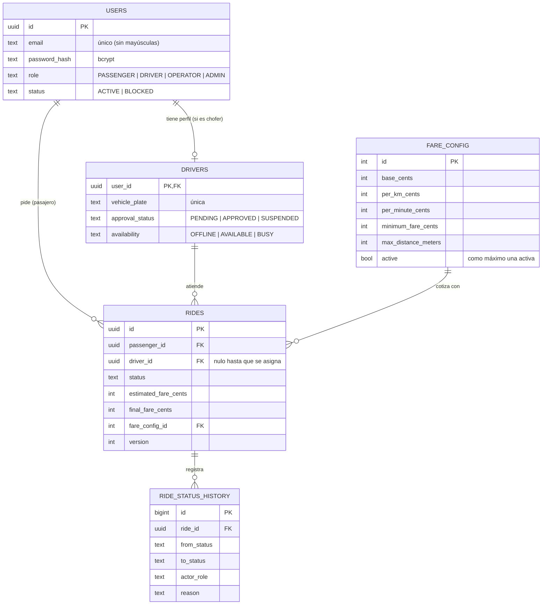
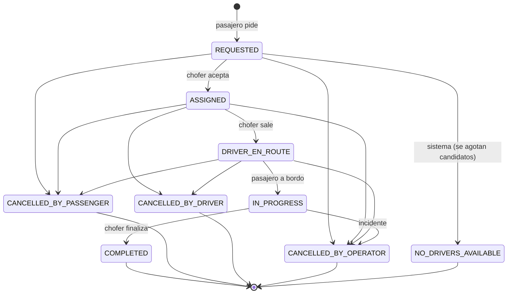

# Modelo de dominio

> Enunciado §2.5: entidades, invariantes y estados, con diagrama.
> Código: `backend/src/domain/` (reglas puras, sin Express ni base de datos) y `backend/db/migrations/` (esquema).

## 1. Glosario

| Término | Significado |
|---|---|
| **Viaje** | Pedido de un pasajero para ir de un origen a un destino. Avanza por la máquina de estados de §4. |
| **Viaje activo** | Viaje en `REQUESTED`, `ASSIGNED`, `DRIVER_EN_ROUTE` o `IN_PROGRESS` (para el chofer no cuenta `REQUESTED`). |
| **Chofer habilitado** | Chofer con `approval_status = APPROVED`, otorgado por un administrador. |
| **Chofer disponible** | Chofer habilitado con `availability = AVAILABLE`: puede recibir y aceptar viajes. |
| **Candidato** | Chofer disponible con una posición reciente dentro del radio de búsqueda. |
| **Oferta** | Propuesta de un viaje a un candidato, con tiempo límite de aceptación. _Pendiente (TAR-03)._ |
| **Tarifa** | Precio en centavos, calculado siempre en el servidor con una versión de `fare_config`. |

## 2. Roles

| Rol | Puede |
|---|---|
| `PASSENGER` | Cotizar, pedir viaje, cancelar el propio, seguir su viaje, ver su historial. |
| `DRIVER` | Declararse disponible, reportar ubicación, aceptar viajes, avanzar el estado del suyo, ver su historial. |
| `OPERATOR` | Ver viajes en curso y cancelarlos con motivo. |
| `ADMIN` | Habilitar choferes y configurar tarifas, zonas y parámetros. |

## 3. Entidades

Convenciones: montos en **centavos enteros** (nunca `number` con decimales), distancias en metros, duraciones en segundos,
fechas `timestamptz` en UTC. `fare_config` nunca se edita: se inserta una versión nueva y se activa; cada viaje guarda con
qué versión se cotizó para poder explicar su precio después.

## 4. Máquina de estados del viaje

Definida en `backend/src/domain/rides/rideStateMachine.ts` como una tabla explícita *desde → hacia → quién puede*.
Una transición que no está en la tabla se rechaza (`INVALID_RIDE_TRANSITION`, 409); una que existe pero la dispara un rol
que no corresponde se rechaza con `RIDE_TRANSITION_NOT_ALLOWED_FOR_ACTOR` (403).

| Desde | Hacia | Quién | Efectos |
|---|---|---|---|
| REQUESTED | ASSIGNED | DRIVER (habilitado y disponible) | Chofer → `BUSY` |
| REQUESTED | NO_DRIVERS_AVAILABLE | SYSTEM | Se avisa al pasajero (pendiente TAR-03) |
| REQUESTED / ASSIGNED / DRIVER_EN_ROUTE | CANCELLED_BY_PASSENGER | PASSENGER dueño | Si había chofer → `AVAILABLE` |
| ASSIGNED / DRIVER_EN_ROUTE | CANCELLED_BY_DRIVER | DRIVER asignado | Chofer → `AVAILABLE` |
| cualquiera no terminal | CANCELLED_BY_OPERATOR | OPERATOR, con motivo | Si había chofer → `AVAILABLE` |
| ASSIGNED | DRIVER_EN_ROUTE | DRIVER asignado | — |
| DRIVER_EN_ROUTE | IN_PROGRESS | DRIVER asignado | — |
| IN_PROGRESS | COMPLETED | DRIVER asignado | Tarifa final con la misma función; chofer → `AVAILABLE` |

Decisiones a confirmar por el grupo:
- `CANCELLED_BY_OPERATOR` no está en la lista del enunciado; se agrega para distinguir la cancelación del operador en la auditoría.
- Con el pasajero a bordo (`IN_PROGRESS`) solo el operador puede cortar el viaje.
- La cancelación del chofer es terminal (el pasajero tiene que volver a pedir); la reasignación automática no forma parte de nuestra variante.

## 5. Invariantes

| # | Invariante | Cómo se garantiza | Test |
|---|---|---|---|
| 1 | Un viaje tiene como máximo un chofer asignado | Lock de la fila del viaje en `AcceptRide` (ADR-0004) | `acceptRide.postgres.test.ts` (50 simultáneas) |
| 2 | Un chofer tiene como máximo un viaje activo | Lock de la fila del chofer + índice único parcial `rides_one_active_per_driver` | `acceptRide.postgres.test.ts` (10 viajes a la vez + red de seguridad) |
| 3 | Un pasajero tiene como máximo un viaje activo | Índice único parcial `rides_one_active_per_passenger` | `acceptRide.postgres.test.ts` |
| 4 | Un chofer `BUSY` siempre tiene un viaje activo | Solo los casos de uso del viaje cambian `BUSY`, dentro de la misma transacción | `cancelVsAccept.postgres.test.ts` (sin choferes huérfanos) |
| 5 | Estado y chofer son coherentes (asignado ⇒ hay chofer; solicitado ⇒ no hay) | `CHECK rides_driver_matches_status` | — |
| 6 | Solo choferes habilitados y disponibles aceptan viajes | Verificación con la fila bloqueada en `AcceptRide` | `acceptRide.test.ts` |
| 7 | Un estado terminal no cambia | Máquina de estados (sin transiciones de salida) | `rideStateMachine.test.ts` (324 combinaciones) |
| 8 | La tarifa la calcula el servidor; estimación y cierre usan la misma función | `calculateFare` pura, en centavos | `fare.test.ts` (bordes: distancia 0, máximo, redondeo) |
| 9 | El historial de estados no se edita | Tabla solo de inserción; ningún caso de uso hace UPDATE/DELETE sobre ella | — |

## 6. Estado de implementación

El modelo de este documento ya existe en el dominio (`domain/rides`, `domain/drivers`, `domain/ports`) y en el esquema
(`001_initial_schema.sql`), con los casos de uso `AcceptRide` y `CancelRide` sobre PostgreSQL. La API HTTP todavía usa
el modelo anterior en memoria (`domain/entities`, `RideService`) hasta que se migre.
